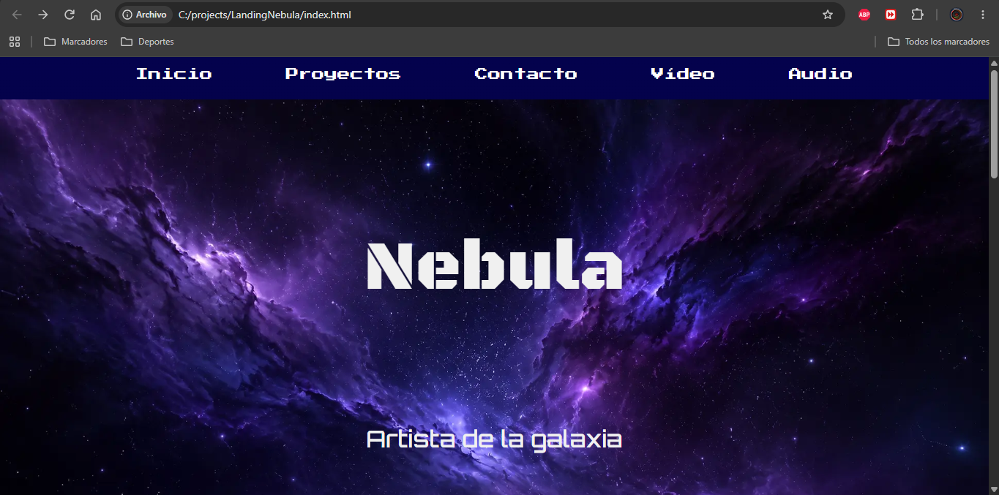
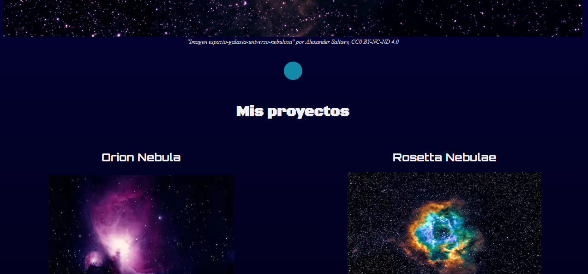
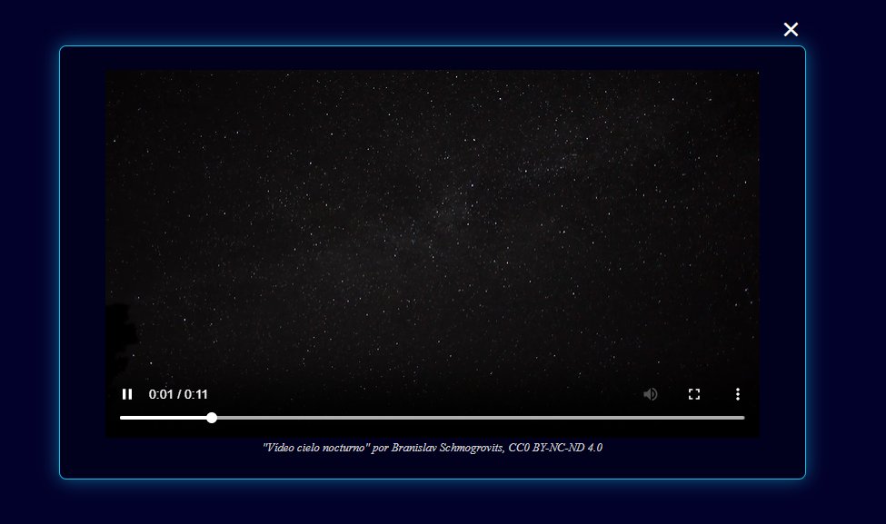
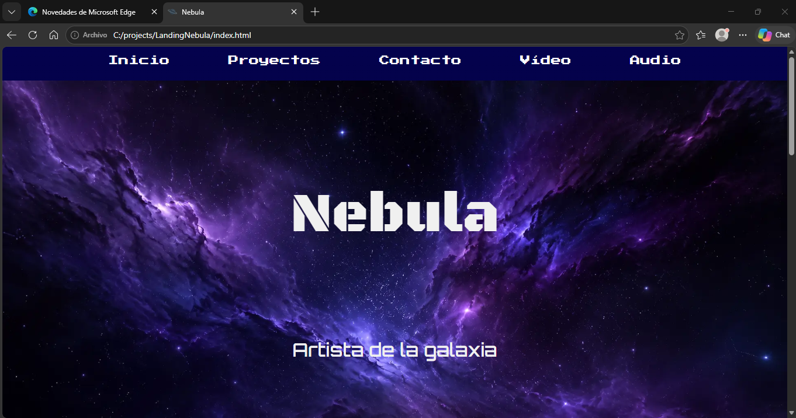
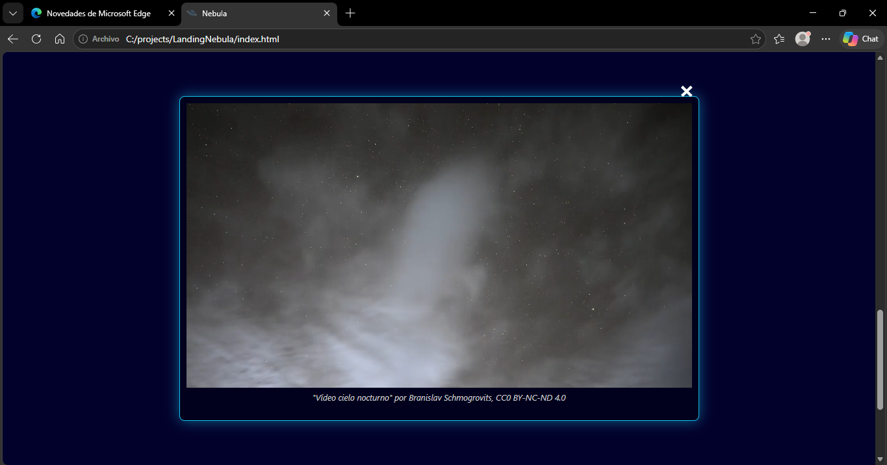
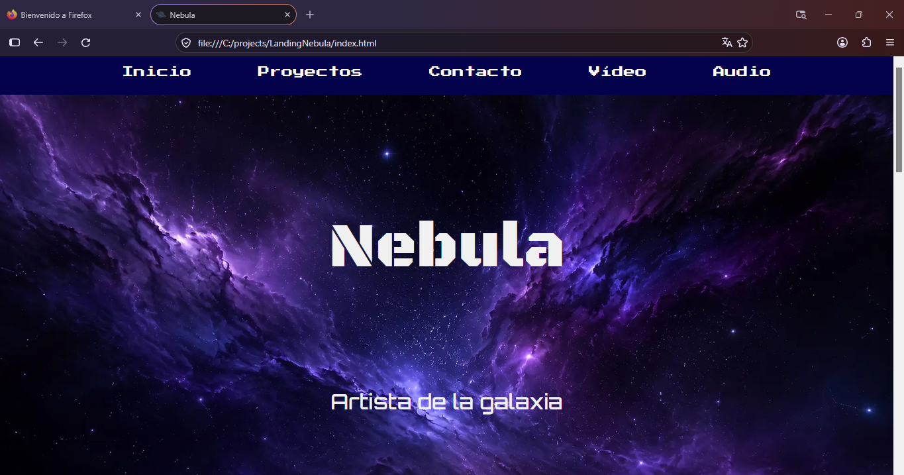
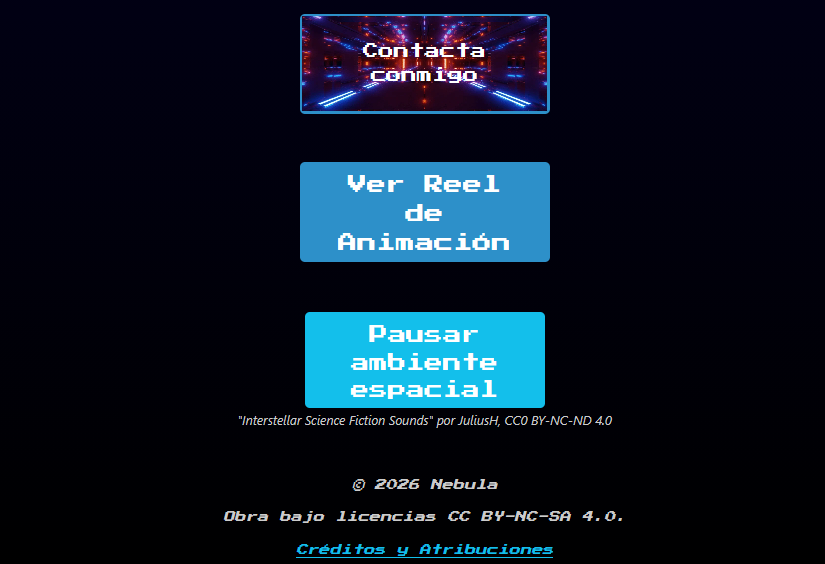
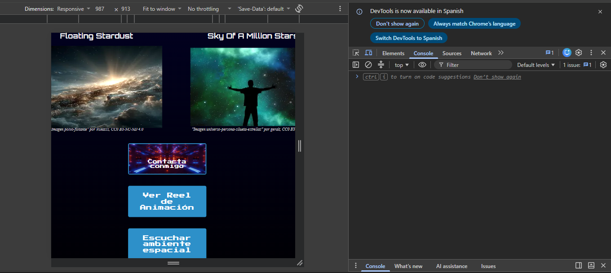

# LandingNebula
Repo para la actividad de Interfaces de crear una Landing Page para Nebula.

El  proyecto contiene los diferentes elementos de la página web, una Landing Page diseñada específicamente para una artista digital llamada Nebula.

Además de los imprescindibles archivos HTML y CSS, la carpeta assets contiene todos los recursos multimedia empleados en la web, organizados por categoría en función de si son imágenes, audio o vídeo. En sus respectivas carpetas se podrá acceder a ellos.

**Tabla** que lista los recursos utilizados en esta landing junto a sus enlaces, así como sus respectivas licencias.

| Recurso | Enlace | Licencia |
|:--------:|:--------:|:--------:|
| Imagen Hero | https://pixabay.com/es/illustrations/espacio-galaxia-universo-nebulosa-10443904/ | CC0 BY-NC-ND 4.0 |
| Imagen Proyecto 1 | https://pixabay.com/es/photos/fondo-de-navidad-nebula-de-ori%C3%B3n-11107/ | CC0 BY-NC-ND 4.0 |
| Imagen Proyecto 2 | https://pixabay.com/es/photos/nebulosa-roseta-nebulosa-universo-7616742/ | CC0 BY-NC-ND 4.0 |
| Imagen Proyecto 3 | https://pixabay.com/es/illustrations/part%C3%ADcula-polvo-flotador-navidad-10066583/ | CC0 BY-NC-ND 4.0 |
| Imagen Proyecto 4 | https://pixabay.com/es/illustrations/universo-persona-silueta-estrellas-1044107/ | CC0 BY-NC-ND 4.0 |
| Logo de Nebula | https://pixabay.com/es/vectors/planeta-espacio-universo-naturaleza-9598022/ | CC0 BY-NC-ND 4.0 |
| Imagen Animación 1 | https://pixabay.com/es/illustrations/ai-generado-lineas-digitales-digital-9110642/ | CC0 BY-NC-ND 4.0 |
| Imagen Animación 2 | https://pixabay.com/es/illustrations/retro-fondo-el-env%C3%ADo-paisaje-4237850/ | CC0 BY-NC-ND 4.0 |
| Imagen Animación 3 | https://pixabay.com/es/illustrations/ciudad-atardecer-noche-paisaje-5848267/ | CC0 BY-NC-ND 4.0 |
| Imagen Animación 4 | https://pixabay.com/es/illustrations/futurista-t%C3%BAnel-ciencia-ficci%C3%B3n-4544119/ | CC0 BY-NC-ND 4.0 |
| Animación webp| https://github.com/aduarte418/LandingNebula/blob/main/assets/img/button-animation.webp | CC0 BY-NC-ND 4.0 |
| Vídeo | https://www.pexels.com/es-es/video/cielo-noche-espacio-estrellas-12354568/ | CC0 BY-NC-ND 4.0 |
| Imagen Miniatura Vídeo | https://github.com/aduarte418/LandingNebula/blob/main/assets/img/poster.webp | CC0 BY-NC-ND 4.0 |
| Audio Ambiente | https://pixabay.com/es/sound-effects/musical-interstellar-science-fiction-sounds-8239/ | CC0 BY-NC-ND 4.0 |

----------------------------------------

**Documentación y Justificación**

Por último, se incluye la documentación de los procedimientos seguidos y las decisiones tomadas en cuanto a la gestión de los recursos de la Landing Page.

La imagen de la Zona Hero fue redimensionada para que su ancho exacto fuese de 1920px mantiendo el aspect ratio, especificando que partiendo de un archivo jpg se convirtió a formato webp para reducir su peso sin perder calidad (ocupa tan sólo 93 kB).

Se siguió el mismo procedimiento para las imágenes que constituyen los trabajos de la artista y que están dispuestos en el grid. Se convirtieron a formato webp para reducir su peso manteniendo calidad, redimensionándose y asegurándose en el propio HTML que las miniaturas tenían un tamaño de 400px x 250px.

El icono seleccionado como logo de Nebula y su sitio web se importó en formato vectorial (svg), siendo una elección ideal para su propósito al no limitar su escalabilidad y permitirle mantener su resolución y calidad al cambiar de tamaño, pudiéndose además insertar en línea (inline) en el propio HTML. 

Para la animación, se ha utilizado un webp animado a partir de 4 imágenes acordes a la temática de la landing, para así ofrecer mejor relación de compresión y rendimiento, así como una mayor compatibilidad. 

Para el vídeo, se ha utilizado un clip de unos 10 segundos en formato mp4 con Códec H.264, ofreciendo buena relación de compresión y sobre todo compatibilidad universal. Además, pesa solamente 2,91 MB. La imagen tomada como miniatura para el vídeo se seleccionó como captura del propio vídeo y se optimizó como el resto de imágenes.

Para el audio ambiente, se ha seleccionado un clip de audio recortado para que dure 15 segundos y que se ha exportado a formato mp3, el más universal y reconocido por todos los navegadores, con una tasa de bits de 256 kbps que ofrece calidad suficiente y en estéreo.

----------------------------------------

**Herramientas utilizadas:**

**Squoosh** para redimensionar y convertir imágenes.

**Audacity** para recortar audio.

**HandBrake** para transcodificar vídeo.

**Ezgif** para realizar la animación.

----------------------------------------

**Justificación de Compatibilidad de Licencias**

El tipo de licencia elegida para el proyecto de la Landing de Nebula es CC BY-NC-ND 4.0. Los recursos multimedia utilizados (extraídos de las webs Pixabay y Pexels) tienen licencias de libre uso no comercial (CC BY-NC), integrándose en la presente obra.

En el hipotético escenario "¿Qué ocurriría si un recurso fuera CC BY-SA?", la cláusula SA (ShareAlike / CompartirIgual) obliga a que cualquier obra derivada que incorpore dicho recurso deba distribuirse estrictamente bajo la misma licencia o una compatible (CC BY-SA).
Esto significa que si uno de mis recursos (como por ejemplo, una imagen de las nebulosas) tiene licencia CC BY-SA 4.0, el proyecto completo de la Landing no podría tener una licencia con cláusula No Comercial (NC) como CC BY-NC-SA ni restrictiva ("Todos los derechos reservados"), sino que habría que licenciar toda la Landing Page bajo CC BY-SA 4.0.

**Verificación Cross-Browser y Responsive**

Se ha comprobado que la página se visualiza y es funcional en diferente navegadores (Chrome, Edge y Firefox), pudiendo abrirse la landing, comprobar el feedback visual del logo, la galería dinámica, la reproducción del vídeo en ventana modal y el botón para reproducir el sonido ambiente.
A continuación se muestran capturas que prueban la funcionalidad en cada navegador.

*Chrome*

Landing visualizada en Chrome

Funcionalidad de la galería (cambia el tamaño de la miniatura ofreciendo feedback visual y actualiza la imagen principal)

Vídeo en ventana modal

*Edge*

Landing visualizada en Edge

Vídeo visualizado en la ventana modal en Edge

*Firefox*

Landing visualizada en Firefox

Funcionalidad del audio teniendo lugar en Firefox

Por último, se ha comprobado mediante las DevTools (F12) que la página y sus recursos son responsive para diferentes dispositivos, asegurando los controles táctiles en su versión para tablet y móvil (los botones cumplen el requisito de tener una dimensiones superiores a 44x44px). 

**Enlace a la página en Github Pages:**

https://aduarte418.github.io/LandingNebula/

